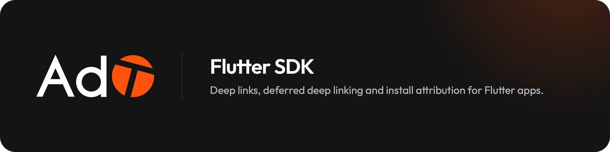

<p align="center">
  <a href="https://adto.app"></a>
</p>

<div align="center">

# flutter_adto

*Deep links, deferred deep links and install attribution for Flutter apps on AdTo*

[](LICENSE)


[](https://docs.adto.app/sdk/installation/)

[Installation](#installation) • [Setup](#setup) • [Handle links](#handle-links) • [Install attribution](#install-attribution) • [Events](#events) • [Links](#create-links-from-the-app) • [Privacy](#what-the-sdk-collects) • [Testing](#testing-install-attribution)

</div>

The Flutter SDK for [AdTo](https://adto.app): links that open your app when it is
installed and the store when it is not, deferred deep links that survive the install, install
attribution you can audit, and post-install events. It talks to AdTo at `app.adto.app`.

For AI coding agents the package ships [`llms.txt`](llms.txt): every public type and member,
the link URLs the SDK recognizes and the init snippets in one file, available offline in the
pub cache. It is generated from [`doc/api-reference.md`](doc/api-reference.md).

## Installation

```yaml
dependencies:
  flutter_adto: ^1.0.0
```

Requirements: Flutter 3.29 or newer (Dart 3.7), iOS 15+, Android 7+ (API 24). Dependency
ranges are kept wide (`app_links` 6–7, `connectivity_plus` 6–7, `device_info_plus` 11.2–13,
`package_info_plus` 8.3–10, `http` 1.x, `rxdart` 0.27–0.28) so the package drops into apps
that already pin these. On iOS the plugin is a Swift package: hosts on Swift Package Manager
need no extra step, and hosts that disabled SwiftPM get the same code through CocoaPods.

## Moving from flutter_adto

flutter_adto is the SDK of the AdTo service (adto.app); flutter_adto is the SDK of AdTo, a
separate service with its own accounts, keys and names. Moving an app means an AdTo account and a
fresh start: nothing the SDK kept on the device carries over, so the app's current users arrive
on AdTo as new installs.

1. In `pubspec.yaml`, replace `flutter_adto` with `flutter_adto` (and `flutter_adto_adid` with
   `flutter_adto_adid`), and import `package:flutter_adto/flutter_adto.dart`.
2. Rename the types: `FlutterAdto` becomes `FlutterAdto`, and every other `Adto` prefix
   becomes `Adto` (`AdtoConfig`, `AdtoLink`, `AdtoError`, `AdtoPasteButton`,
   `AdtoNavigatorObserver`…).
3. Use the SDK key (`adto_pub_…`) of the app's AdTo account, and drop any `baseUrl` and
   `linkRootDomain`: the SDK defaults to `https://app.adto.app` and links on `{username}.adto.app`.
4. Change the associated domains and intent filters to the AdTo link host, and the app's routing
   to the AdTo link parameters (`adto_deeplink` and the rest).
5. On iOS, run `flutter pub get`, then `pod install` if the app uses CocoaPods.

## Setup

### 1. Get an SDK key

Sign up at [app.adto.app](https://app.adto.app/login) and pick a username: it is your link
subdomain, `<username>.adto.app`. Dashboard → Settings shows your **SDK key** (`adto_pub_…`).
The account key (`adto_…`) is for servers and scripts and never goes in an app.

### 2. Register the link host

**Android**, in `android/app/src/main/AndroidManifest.xml`:

```xml
<intent-filter android:autoVerify="true">
    <action android:name="android.intent.action.VIEW" />
    <category android:name="android.intent.category.DEFAULT" />
    <category android:name="android.intent.category.BROWSABLE" />
    <data android:scheme="https" android:host="YOUR_USERNAME.adto.app" />
</intent-filter>
```

**iOS**, in `ios/Runner/Runner.entitlements` (create it if missing, and enable the Associated
Domains capability for the app in your Apple Developer account):

```xml
<key>com.apple.developer.associated-domains</key>
<array>
    <string>applinks:YOUR_USERNAME.adto.app</string>
</array>
```

The dashboard's Apps page shows these entries filled in for your app, and its setup checklist
confirms the association files are served. Custom link domains and the test environment host
go in the same places; see [Platform setup](https://docs.adto.app/sdk/platform-setup/).

### 3. Initialize

```dart
import 'package:flutter_adto/flutter_adto.dart';

final adto = FlutterAdto();

await adto.initialize(AdtoConfig(
  apiKey: 'adto_pub_your_sdk_key',
  enableDebugLogging: true,
));
```

That is all AdTo needs: the SDK defaults to the API at `https://app.adto.app` and links on
`{username}.adto.app`.

Every `AdtoConfig` option (consent, the collection switches, the Meta referrer, Apple Search
Ads, the test environment) is in the [API reference](doc/api-reference.md#adtoconfig).

## Handle links

Subscribe before `initialize()` finishes: the link that opened the app arrives during it.

```dart
adto.onLinkClick.listen((linkClick) {
  // Route on adto_deeplink when the URL carries one, else on the link's own path.
  final route = linkClick.clickParams?.deepLink ?? linkClick.linkResolution?.deepLinkPath;
  if (route != null) _openRoute(route);
});

// The link that launched the app, for code that runs after the stream delivered it.
final initialLink = await adto.getInitialLink();
```

The launch link is consumed once per process, however many times `getInitialLink()` and
`onLinkClick` deliver it, and an Android launch from the recents screen is ignored. OAuth and
social-login callback URLs are never logged or emitted. `handleUrl(url)` routes an AdTo link
tapped inside the app. Details: [Initialize and handle links](https://docs.adto.app/sdk/initialize-and-handle-links/).

## Install attribution

The SDK registers the install on the first launch and tells you where it came from:

```dart
adto.onAppInstalled.listen((install) {
  if (install.matched) {
    // A user who tapped an AdTo link before installing.
    print('Install attributed to ${install.username}/${install.slug}');
  } else {
    // Organic: no prior link click.
  }
});

final verdict = await adto.getAttributionData(); // the cached verdict, on any later launch
```

**Routing vs credit.** `matched` is attribution *credit*, granted only at `matchConfidence`
`guaranteed` (install referrer, Meta, pasteboard) or `high`. A probabilistic candidate the
server is less sure about still comes back as `routing` (`AdtoDeferredRoute`: `slug`,
`deepLink`, `clickParams`, `confidence`) at `medium` confidence with `matched: false`: use it to
route a new user to the content they tapped, because routing is cheap to get wrong and credit
is not. A tie between candidates is `low` and yields neither.

```dart
adto.onAppInstalled.listen((install) {
  final route = install.routing?.deepLink ?? install.deepLink;
  if (route != null) _openRoute(route);          // medium or better
  if (install.matched) _creditInstall(install);  // high or guaranteed only
});
```

`onAppInstalled` can emit more than once: when a deterministic signal arrives after the first
registration (a Play referrer that was not ready in time, a link pasted through
`AdtoPasteButton`) the SDK sends a late claim and re-emits the upgraded verdict
(`claim == 'upgraded'`). `currentAppInstall` always holds the latest one. An existing user who
only updated to an SDK build (`installState == 'update'`) is never fingerprint-matched, and a
retried first launch can never register a second install.

### Deterministic signals

- **Android install referrers.** AdTo puts the click id in the store's install referrer
  (`referrer=adto_click=<id>&adto_l=<username>/<slug>`); the SDK's native reader (modelled on
  the Adjust and Branch readers) reads it back from Google Play and, with
  `AdtoCollection.oemReferrers` (on by default), from Huawei AppGallery and vivo. The
  Samsung Galaxy Store and Xiaomi GetApps readers activate when the host app adds their
  referrer libraries. The read waits at most `installReferrerTimeout` (5 s) and a late answer
  becomes a claim. No setup is required.
- **iOS pasteboard.** On the first launch the SDK checks the pasteboard silently
  (`UIPasteboard.hasURLs`) and reads it only when it holds a URL; only an AdTo link that names
  a click is sent, anything else is left alone. The dashboard's *iOS tap-to-store* page is the
  web side that copies the link before opening the App Store. On iOS 16+ the read shows the
  system "Allow paste" alert; `willShowPasteboardPrompt()` tells you beforehand, and
  `AdtoPasteButton` (Apple's `UIPasteControl`) lets a user paste an invite link without it.
- **Meta's on-device referrer** (`fbAppId`) and **Apple Search Ads**
  (`AdtoCollection.appleSearchAdsToken`, resolved server-side) are opt-in.

The whole ladder, with what each signal needs from the app, is under
[Deterministic attribution](https://docs.adto.app/sdk/deterministic-attribution/).

## Events

Events queue durably on the device and go out in batches. The server stamps each with the
install's matched link and the link that last re-opened the app, so the dashboard shows leads
and revenue per link.

```dart
// The first identify of a new user on a fresh install is their signup lead.
// Unchanged repeat calls are skipped, so calling it on every launch is safe.
await adto.identify(customerId: user.id, email: user.email);

await adto.trackConversion(
  revenue: 9.99,
  currency: 'USD',
  transactionId: purchase.transactionId, // counted once, even if reported again
  store: AdtoStore.appStore,
);
await adto.trackEvent('level_up', data: {'level': 3});
await adto.trackScreenView('product', params: {'id': 42});   // outside every event total
// or every page route at once:
// MaterialApp(navigatorObservers: [AdtoNavigatorObserver()])

await adto.flush();   // force-send (otherwise 20 events / 30 s)
await adto.logout();  // flush + forget the customer id
```

**Consent first.** Initialize with `AdtoConfig(enabled: false)` and nothing is sent, and the
pasteboard is never read, until `setEnabled(true)`; then the install, the held events and the
launch link's report go out. The choice is persisted and wins over `enabled` on later launches.
`setEnabled(false)` stops all collection at any time.

More in [Events](https://docs.adto.app/sdk/events/) and [Revenue](https://docs.adto.app/sdk/revenue/).

## Create links from the app

```dart
// Only slug is required; a null target inherits the app's fallback URL.
final link = await adto.createLink(
  slug: 'my-link',
  target: 'https://example.com',
  iosDeepLinkPath: 'products/42',
  androidDeepLinkPath: 'products/42',
  campaign: 'spring',
);

await adto.updateLink('my-link', campaign: 'summer', ogTitle: ''); // null keeps, '' clears

final temp = await adto.createTempLink(target: 'https://example.com', ttlSeconds: 3600);

// One referral link per customer, created on first use; needs no links:write key.
final invite = await adto.createReferralLink(customerId: user.id);
```

`getLinks`, `getLink`, `deleteLink`, `resolveLink` and the temporary-link equivalents complete
the set; creating and changing links needs an SDK key with `links:write`. See
[Create links from the app](https://docs.adto.app/sdk/create-links-from-the-app/).

## What the SDK collects

Everything respects `setEnabled(false)` and the `AdtoConfig.collect` switches, and is
declared in the bundled iOS privacy manifest.

- **Device tier** (on by default): a vendor-scoped device id (`ANDROID_ID`, or the IDFV kept
  in the Keychain so it survives a reinstall; `persistDeviceId: false` sends the plain IDFV),
  model, OS, screen metrics, connectivity and carrier, and the display and accessibility
  settings (text size and Increase Contrast on iOS, dark mode and reduce motion on both).
- **Store install referrers** on Android and a **copied AdTo link** on iOS, as above.
- **What the app passes** to `identify` and the event calls.

The core package never reads an advertising id: no Play services dependency, no `AD_ID`
permission, no AdSupport or App Tracking Transparency. Apps that want one add
[`flutter_adto_adid`](packages/flutter_adto_adid), which handles the ATT prompt and passes
the id through `advertisingIdProvider`. The store disclosure for each switch is in the
[API reference](doc/api-reference.md#adtoconfig) and under
[Device data and privacy](https://docs.adto.app/sdk/device-data-and-privacy/).

## Testing install attribution

Keep test traffic out of your live numbers with a test environment (dashboard Settings → Test
environment): a second account, `t-<username>`, with the same apps. Put its SDK key in debug
builds and add `t-<username>.adto.app` to their associated domains:

```dart
await adto.initialize(AdtoConfig(
  apiKey: kReleaseMode ? liveSdkKey : testSdkKey,
));
```

The key alone decides which account gets the data. `AdtoConfig(environment:)` is an optional
check, not a switch, and changes nothing at runtime: when the app calls `diagnostics()`, it warns
if the key belongs to the other environment. Without it, `diagnostics()` still warns about a test
key in a release build.

To simulate a first install, delete the app (iOS) or run `adb shell pm clear <package>`
(Android), tap an AdTo link, install and open the app: `onAppInstalled` fires with
`matched: true`. `diagnostics()` compares the build with the dashboard's record of the app
(bundle id or package, URL scheme, App Links verification per host, live or test key) and
reports every mismatch. See [Testing](https://docs.adto.app/sdk/testing/).

## Reference

- [`doc/api-reference.md`](doc/api-reference.md): every public type and member, with the
  store disclosures.
- [`llms.txt`](llms.txt): the same for AI coding agents.
- [docs.adto.app/sdk](https://docs.adto.app/sdk/installation/): setup, attribution,
  events, privacy and troubleshooting.
- [`example/`](example): a Flutter app with every flow. Copy `env/dev.json.example` to
  `env/dev.json`, then `flutter run --dart-define-from-file=env/dev.json`.
- Related: the [server](https://github.com/ad-to/adto) and the
  [React Native SDK](https://github.com/ad-to/react-native-adto), which shares this SDK's
  native reads and golden fixtures.

## Development

```bash
dart format --output=none --set-exit-if-changed lib test tool example/lib
flutter analyze
flutter test                  # mocks the platform channel
cd example && flutter build apk --debug && flutter build ios --simulator --debug   # compiles the Kotlin and Swift
```

The Android plugin builds on AGP 8 and AGP 9 alike, applying the Kotlin Gradle plugin itself
only when neither the host nor Flutter's tooling already did. A public API change updates
`doc/api-reference.md`, then `dart run tool/gen_llms.dart` regenerates `llms.txt`. See
[CONTRIBUTING.md](CONTRIBUTING.md).
